<div align="center">


# SmartQ — Queue Management & Appointment Booking

**Book your turn. Skip the line.**

A web platform + Android app that lets customers book an appointment or take a live queue number at clinics, hospitals, banks, salons, gyms and government offices — and gives every place a calm dashboard to serve people on time.

[](https://smartq.free.je)
[](https://drive.usercontent.google.com/download?id=15uEVxpWX8XrNO_Pps8ss4AWoXTe64ZWq&export=download&confirm=t)


</div>

---

## ✨ Highlights

- **Online booking with real time slots** — schedules are split into slots; the same booking engine powers the website and the app.
- **No double bookings** — every booking runs in a database transaction with row locks plus unique indexes (tested with simultaneous requests: exactly one wins).
- **Smart time suggestion** — "Help me choose" picks the nearest comfortable, least-crowded slot.
- **Live queue ticket** — queue codes like `Q-007`, status, and a countdown to your turn.
- **Passwordless sign-in** — 6-digit email code (via Brevo) and optional Google sign-in; classic password login is still available.
- **Guest browsing** — explore places and times without an account; booking asks you to sign in and brings you right back.
- **Email confirmations & reminders** — sent automatically before the appointment (works on shared hosting without cron).
- **Three workspaces** — Customer, Manager (places, schedules, bookings, customers, CSV/PDF export) and Admin (users, managers, analytics).
- **Arabic & English (RTL)** and **Light / Dark mode** on both the website and the app.
- **Security** — CSRF protection, role & ownership checks, prepared statements, hashed passwords, expiring API tokens, safe uploads.

## 📸 Screenshots

### Website
| Landing | Arabic · Dark | Customer dashboard |
|---|---|---|
| 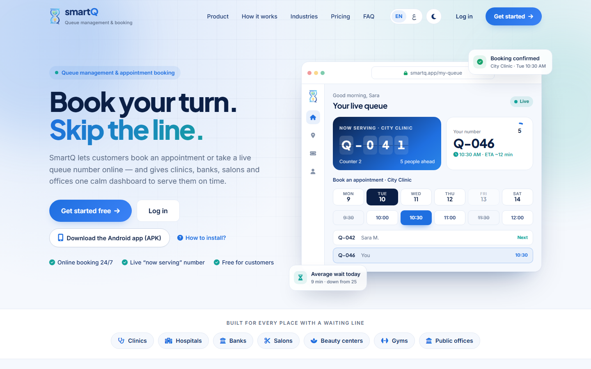 | 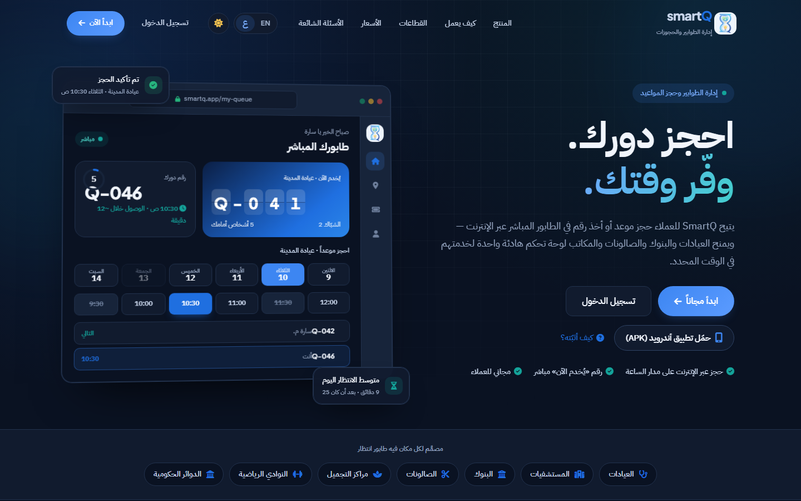 | 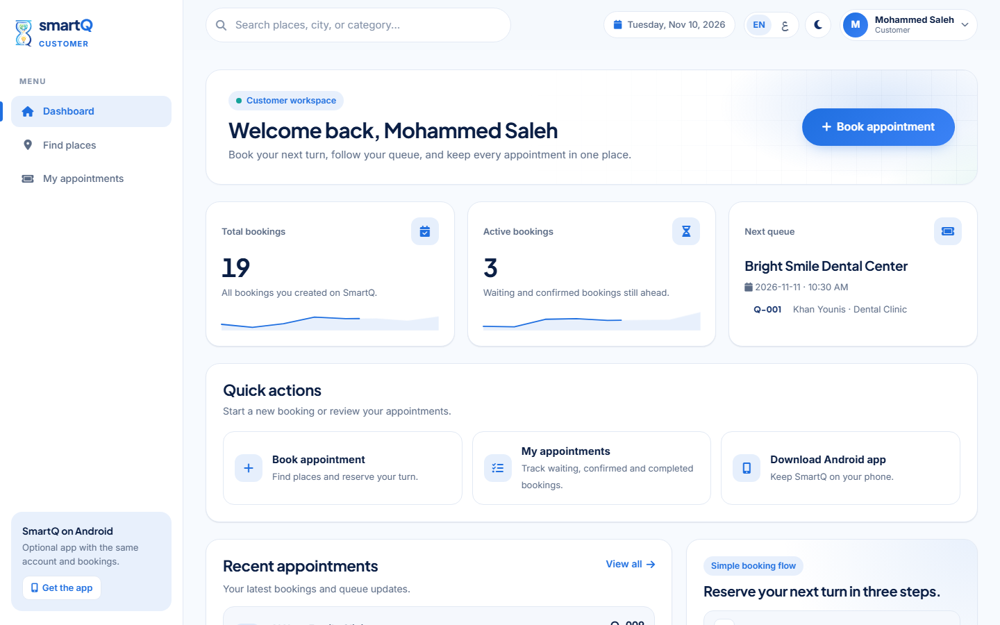 |

### Android app
| Splash | Language | Home · next turn | Arabic | Dark |
|---|---|---|---|---|
| 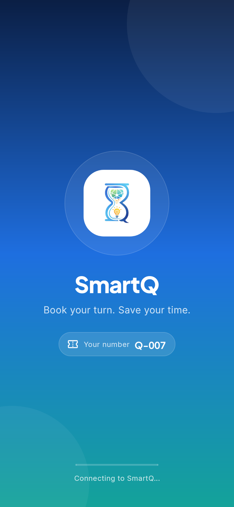 | 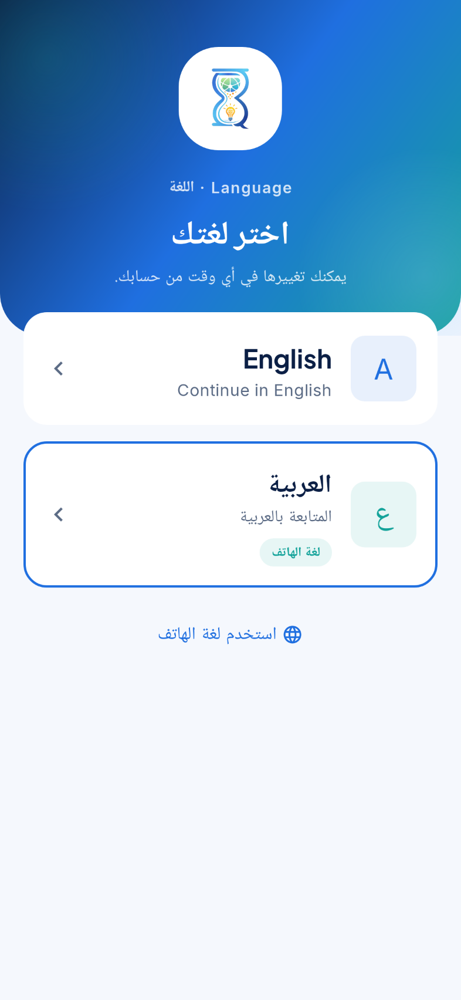 | 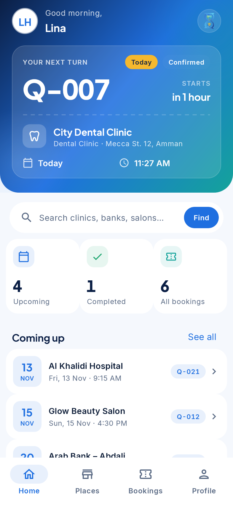 | 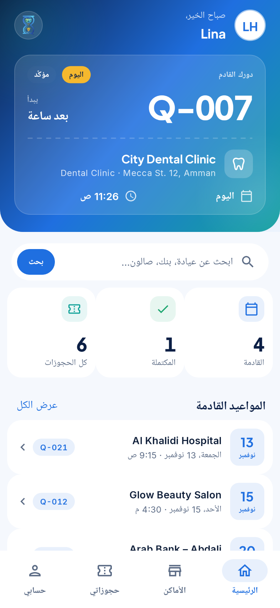 | 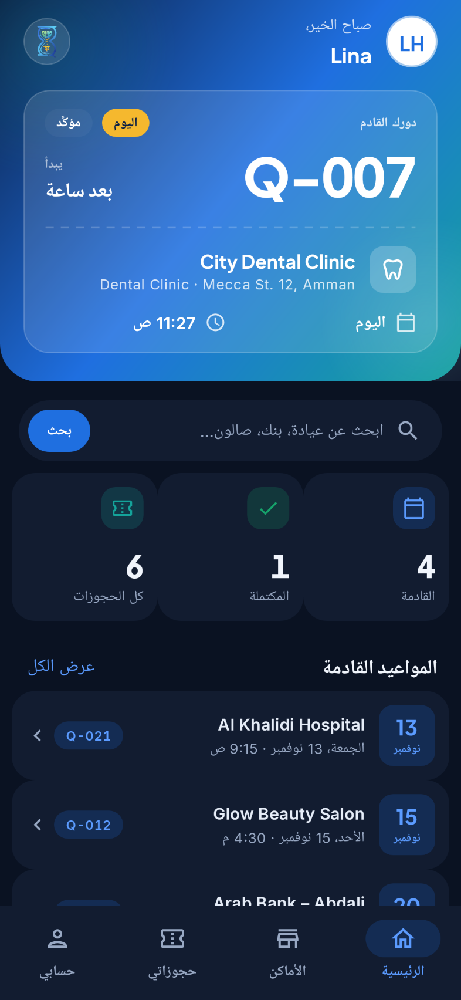 |

| Places | Pick a time | Booked! | My bookings |
|---|---|---|---|
| 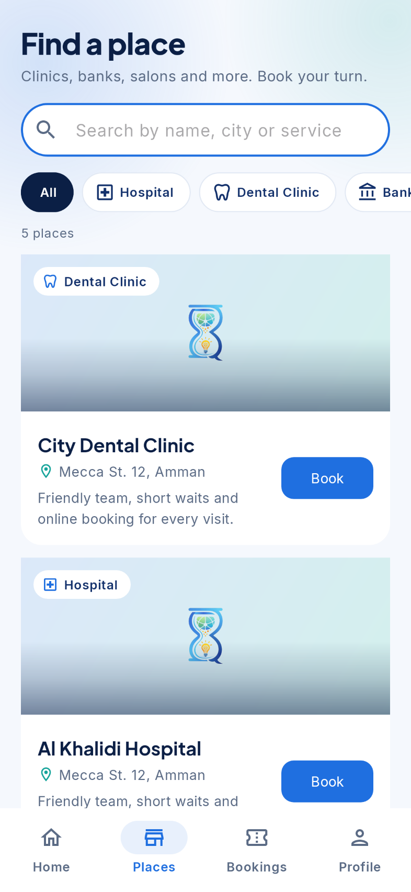 | 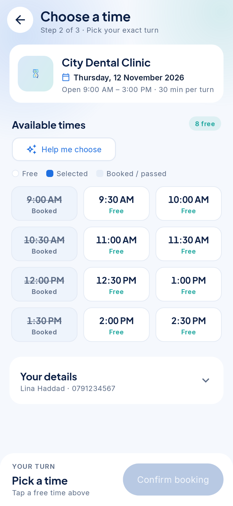 | 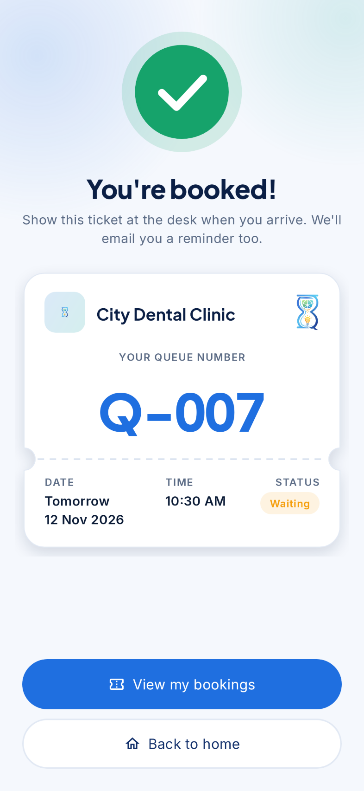 | 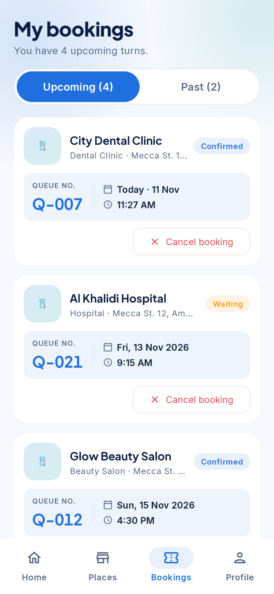 |

## 🏗️ Architecture

```
            ┌──────────────────────┐        ┌───────────────────────┐
Browser ───▶│  Website (PHP pages) │        │  Android app (Java)   │
            │  user / manager /    │        │  single ApiClient,    │
            │  admin workspaces    │        │  guest mode, AR/EN    │
            └─────────┬────────────┘        └──────────┬────────────┘
                      │  same services                 │ JSON REST API (api/user/*)
                      ▼                                ▼
            ┌──────────────────────────────────────────────────────┐
            │ config/booking.php  · one booking engine (slots, locks)│
            │ config/auth_service · email codes, Google, tokens      │
            │ config/mailer.php   · Brevo emails + reminders         │
            └──────────────────────────┬───────────────────────────┘
                                       ▼
                               MySQL / MariaDB
```

## 🧰 Tech stack

| Layer | Technology |
|---|---|
| Website | PHP 8, MySQL/MariaDB (mysqli, prepared statements), vanilla JS, CSS design system |
| Mobile | Android (Java), Material 3, AndroidX Credential Manager, HttpURLConnection |
| Email | Brevo transactional API (HTTPS) |
| Hosting | InfinityFree (free PHP hosting) — includes a workaround for its anti-bot challenge in the app |

## 📁 Project structure

```
SmartQ/
├── web/                 # Website + REST API
│   ├── api/             # JSON API used by the Android app
│   ├── auth/            # Email-code & Google sign-in endpoints
│   ├── config/          # Shared services (booking, auth, mailer, i18n, security)
│   ├── database/        # Migrations + demo seed
│   ├── install/         # One-time installer for shared hosting
│   ├── lang/            # English / Arabic dictionaries
│   ├── user/ manager/ admin/   # The three workspaces
│   └── css/ js/ img/
├── android/             # Android app (Java)
├── docs/screenshots/    # Images used in this README
└── DESIGN_SYSTEM.md     # Shared colors, type and components for web + app
```

## 🚀 Run locally

**Website (XAMPP or any PHP 8 + MySQL server)**
1. Copy `web/` into your server root (e.g. `htdocs/smartq`).
2. Create a database and import the schema + demo data:
   ```bash
   mysql -u root smartq_db < web/database/seed_demo.sql
   ```
   (or run the migrations in `web/database/` on an existing database).
3. Copy `web/config/config.local.example.php` to `web/config/config.local.php` and set your database (and optionally Brevo / Google) settings.
4. Open `http://localhost/smartq/`.

**Android app**
```bash
cd android
./gradlew assembleDebug -PapiUrl=http://10.0.2.2/smartq/api/user/
```
Optional: `-PgoogleClientId=<your-web-client-id>` to enable Google sign-in.

### Demo accounts
| Role | Email | Password |
|---|---|---|
| Admin | admin@smartq.com | Admin@123 |
| Manager | khaled@smartq.com | Manager@123 |
| Customer | user@smartq.com | User@123 |

## 🇵🇸 بالعربي

**SmartQ** منصة ويب وتطبيق أندرويد لحجز الدور والمواعيد في العيادات والمستشفيات والبنوك والصالونات والدوائر الحكومية.

- حجز موعد بوقت محدد، أو أخذ رقم دور مباشر (مثل `Q-007`).
- اقتراح ذكي لأنسب وقت، ومنع الحجز المزدوج بشكل كامل.
- الدخول بكود يصل على الإيميل بدون كلمة سر، أو بحساب جوجل، أو التصفح كضيف.
- إيميل تأكيد للحجز وتذكير قبل الموعد.
- ثلاث لوحات تحكم: الزبون، المدير (الأماكن والجداول والحجوزات والتقارير)، والأدمن.
- يدعم **العربي والإنجليزي** و**الوضع الفاتح والغامق** في الموقع والتطبيق.

🔗 جرّب الموقع: **[smartq.free.je](https://smartq.free.je)** · 📱 [حمّل التطبيق](https://drive.usercontent.google.com/download?id=15uEVxpWX8XrNO_Pps8ss4AWoXTe64ZWq&export=download&confirm=t)

## 👩‍💻 Author

**Basmalah Qaseem** ([@basmalah-Tarq](https://github.com/basmalah-Tarq)) — Graduation project.

## 📄 License

Released under the [MIT License](LICENSE).
